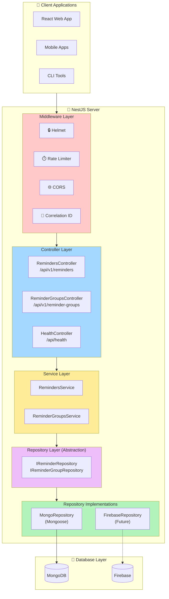
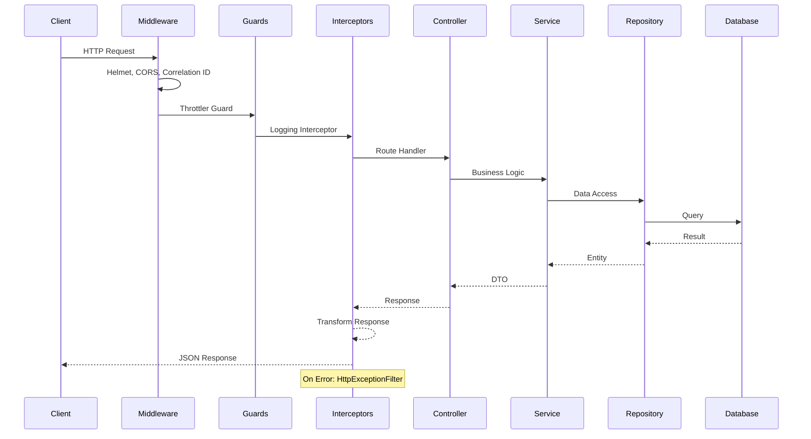
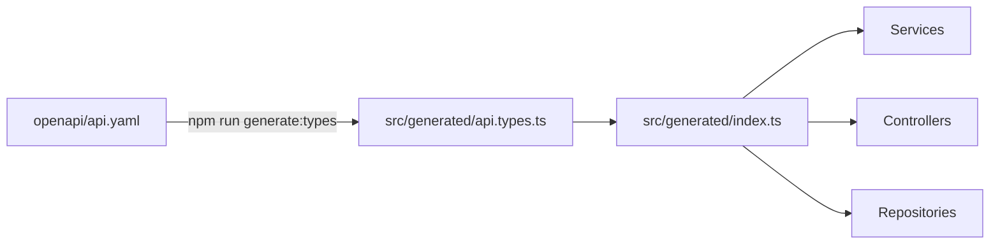

# ReMinder NestJS Server

> Production-grade backend API for the ReMinder application, built with NestJS.


## Table of Contents

- [Overview](#overview)
- [Architecture](#architecture)
- [Quick Start](#quick-start)
- [Project Structure](#project-structure)
- [API Documentation](#api-documentation)
- [Configuration](#configuration)
- [Development](#development)
- [Testing](#testing)
- [Deployment](#deployment)

---

## Overview

This is the backend server for the ReMinder application, providing REST APIs for managing reminders and reminder groups. 

### Key Features

| Feature | Description |
|---------|-------------|
| **Spec-First OpenAPI** | Consumes existing `openapi/api.yaml` - no duplication |
| **Database Abstraction** | Repository pattern for flexible database integration |
| **Zod Validation** | Type-safe environment variable validation |
| **Observability** | Structured logging with Winston, health checks, correlation IDs |
| **Security** | Helmet, rate limiting, CORS, input validation |
| **Developer Experience** | Hot reload, Swagger UI, Docker Compose for local services |

---

## Architecture

### System Overview



### Request Flow




---

## Quick Start

### Prerequisites

- **Node.js** >= 20.x
- **npm** >= 10.x
- **Docker** (for MongoDB)

### One-Command Setup

```bash
# Using Make (recommended)
make setup    # Install deps + start MongoDB + run dev server
```

### Manual Setup

```bash
# 1. Install dependencies
npm install

# 2. Start MongoDB (via Docker)
docker-compose up -d mongodb

# 3. Start development server
npm run start:dev
```

### Verify Installation

| Endpoint | Description |
|----------|-------------|
| http://localhost:3000/api/health/live | Health check |
| http://localhost:3000/api/docs | Swagger UI |
| http://localhost:3000/api/v1/reminders | Reminders API |

---

## Project Structure

```
backend/nestjs-server/
├── src/
│   ├── config/                    # Configuration (Zod validation)
│   │   ├── env.schema.ts          # Environment variable schema
│   │   ├── configuration.ts       # Configuration factory
│   │   └── config.module.ts       # NestJS ConfigModule setup
│   │
│   ├── common/                    # Shared utilities
│   │   ├── filters/               # Exception filters
│   │   ├── interceptors/          # Request/Response interceptors
│   │   └── middleware/            # HTTP middleware
│   │
│   ├── infrastructure/            # Cross-cutting concerns
│   │   ├── health/                # Health check endpoints
│   │   └── logging/               # Winston logging
│   │
│   ├── database/                  # Database layer
│   │   ├── interfaces/            # Repository interfaces (abstraction)
│   │   └── mongodb/               # MongoDB implementation
│   │       ├── schemas/           # Mongoose schemas
│   │       └── repositories/      # Mongoose repositories
│   │
│   ├── modules/                   # Feature modules
│   │   ├── reminders/             # Reminders CRUD
│   │   └── reminder-groups/       # Reminder Groups CRUD
│   │
│   ├── generated/                 # Auto-generated from OpenAPI ⭐
│   │   ├── api.types.ts           # Generated types (DO NOT EDIT)
│   │   └── index.ts               # Convenient type exports
│   │
│   ├── app.module.ts              # Root module
│   └── main.ts                    # Application bootstrap
│
├── test/                          # Tests
├── scripts/                       # Utility scripts
│   └── generate-types.ts          # OpenAPI → TypeScript generator
├── .github/workflows/             # CI/CD
├── docker-compose.yml             # Local services
├── Makefile                       # Developer commands
└── .env.development               # Dev environment
```

---

## Type System (OpenAPI-First)

This project uses **OpenAPI as the single source of truth** for all API types.

### How It Works



### Usage

```typescript
// Import types from generated barrel
import type { 
  Reminder, 
  ReminderState, 
  CreateReminderRequest,
  UpdateReminderRequest 
} from '../../generated';

// Constants are also available
import { REMINDER_STATES } from '../../generated';
```

### Regenerating Types

Types are automatically regenerated on build (`prebuild` hook). To manually regenerate:

```bash
npm run generate:types
```

> **⚠️ Important**: Never manually edit files in `src/generated/`. If you need to change types, update `openapi/api.yaml` and regenerate.

---

## API Documentation

### OpenAPI Spec

The API is defined in `/openapi/api.yaml` (single source of truth). Swagger UI is available at `/api/docs` in development.

### Endpoints

#### Reminders

| Method | Endpoint | Description |
|--------|----------|-------------|
| `GET` | `/api/v1/reminders` | List reminders (filter: `groupId`, `state`) |
| `POST` | `/api/v1/reminders` | Create reminder |
| `PATCH` | `/api/v1/reminders/:id` | Update reminder |
| `DELETE` | `/api/v1/reminders/:id` | Delete reminder |

#### Reminder Groups

| Method | Endpoint | Description |
|--------|----------|-------------|
| `GET` | `/api/v1/reminder-groups` | List groups |
| `GET` | `/api/v1/reminder-groups/:id` | Get single group |
| `POST` | `/api/v1/reminder-groups` | Create group |
| `PATCH` | `/api/v1/reminder-groups/:id` | Update group |
| `DELETE` | `/api/v1/reminder-groups/:id` | Delete group (cascades) |

#### Health

| Method | Endpoint | Description |
|--------|----------|-------------|
| `GET` | `/api/health` | Full health check (DB, Memory, Disk) |
| `GET` | `/api/health/ready` | Readiness probe (DB only) |
| `GET` | `/api/health/live` | Liveness probe (always OK) |

### Response Format

All responses follow a consistent format:

```json
{
  "data": { ... },
  "meta": {
    "timestamp": "2026-01-14T18:07:40.029Z",
    "correlationId": "daef8c6a-5a5d-48c1-bfc0-9318df5fc312"
  }
}
```

---

## Configuration

### Environment Variables

Configuration is validated using **Zod**. See `.env.example` for all options.

| Variable | Default | Description |
|----------|---------|-------------|
| `NODE_ENV` | `development` | Environment mode |
| `PORT` | `3000` | Server port |
| `DB_TYPE` | `mongodb` | Database type (`mongodb`, `firebase`) |
| `MONGO_DB_URI` | - | MongoDB connection string (required) |
| `MONGO_DB_NAME` | `reminder` | Database name |
| `LOG_LEVEL` | `info` | Logging level |
| `ENABLE_HELMET` | `1` | Enable security headers |
| `RATE_LIMIT_MAX` | `100` | Max requests per minute |

### Environment Files

| File | Purpose |
|------|---------|
| `.env.development` | Local development |
| `.env.production` | Production deployment |
| `.env.test` | Test environment |
| `.env.example` | Template with documentation |

---

## Development

### Available Commands

```bash
# Development
make dev          # Start dev server with hot reload
make logs         # Tail server logs

# Database
make db-up        # Start MongoDB
make db-down      # Stop MongoDB
make db-reset     # Reset database

# Code Quality
make lint         # Run ESLint
make format       # Format code with Prettier
make typecheck    # TypeScript type check

# Testing
make test         # Run unit tests
make test-e2e     # Run e2e tests
make test-cov     # Test with coverage

# Build
make build        # Build for production
```

### NPM Scripts Reference

```bash
# Development
npm run start:dev      # Development with hot reload
npm run start:prod     # Production mode
npm run start:debug    # Debug mode with watch

# Build
npm run build          # Compile TypeScript (auto-regenerates types)
npm run clean          # Remove dist folder

# Code Quality
npm run lint           # Run linter
npm run format         # Format code with Prettier
npm run typecheck      # Type check

# Testing
npm run test           # Unit tests
npm run test:watch     # Unit tests in watch mode
npm run test:cov       # Unit tests with coverage
npm run test:e2e       # E2E tests

# Type Generation (OpenAPI)
npm run generate:types # Regenerate TypeScript types from OpenAPI spec
```

---

## Testing

### Unit Tests

```bash
npm run test           # Run once
npm run test:watch     # Watch mode
npm run test:cov       # With coverage
```

### E2E Tests

```bash
# Start test database first
docker-compose up -d mongodb

# Run tests
npm run test:e2e
```

---

## Deployment

### Docker

```bash
# Build image
docker build -t reminder-api .

# Run container
docker run -p 3000:3000 \
  -e MONGO_DB_URI=mongodb://host.docker.internal:27017 \
  reminder-api
```

### CI/CD

GitHub Actions pipeline (`.github/workflows/ci.yml`) runs on every PR:
- Lint + Type check
- Unit tests
- E2E tests (with MongoDB service)
- Build artifacts

---

## Tech Stack

| Category | Technology |
|----------|------------|
| **Framework** | NestJS 10 |
| **Language** | TypeScript 5 |
| **Database** | MongoDB 7 (Mongoose) |
| **Validation** | Zod (env), class-validator (DTOs) |
| **Logging** | Winston |
| **API Docs** | OpenAPI 3.0 / Swagger UI |
| **Security** | Helmet, Throttler |
| **Testing** | Jest, Supertest |
| **CI/CD** | GitHub Actions |

---

## Author

**Amandeep Singh**  
📧 amandeep.singh.fsd@gmail.com

## License

This project is [MIT licensed](LICENSE).
